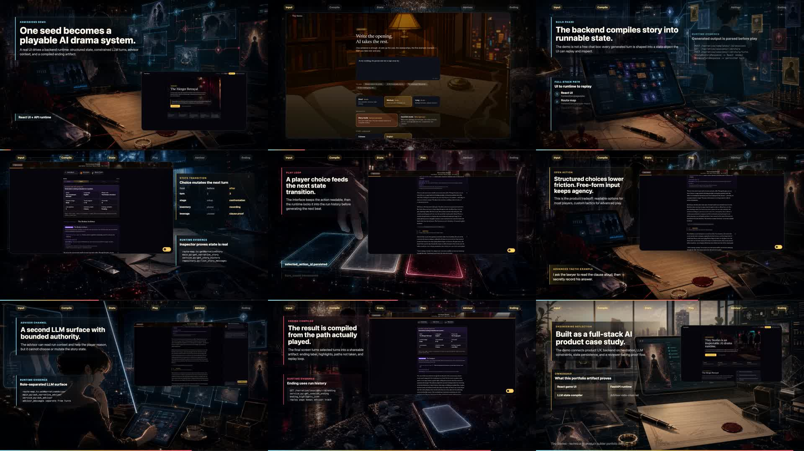

# Tiny Stories

An interactive story system: one premise becomes a 12-turn story of choices or free actions, with saved sessions, replay, and a reviewer view of each turn's state.

**RPG Demo** repository · [中文](./README.zh.md)

<p>
  
  
  
  
  
  
</p>

## Demo

[](https://youtu.be/RRJ7uyjW_nA)

- [Watch the 75s demo on YouTube](https://youtu.be/RRJ7uyjW_nA)
- [MP4 copy of the same cut](./docs/demo-video/tiny-stories-demo-readme.mp4), for places where YouTube is blocked
- [GitHub Pages site](https://lishehao.github.io/RPG_Demo/) and its
  [static reviewer demo](https://lishehao.github.io/RPG_Demo/app/#/demo/reviewer)

The reviewer demo on GitHub Pages is a static, deterministic build: no API
key, no backend, and no live generation. The GitHub Pages copy can lag behind
`main`.

## Why

The project asks one question: can an LLM story generator feel like a
designed game loop instead of a chat window?

The target player wants a short story on a phone, not a blank writing canvas
or an endless feed. Each turn has the same rhythm: read the scene, compare a
few moves (or type your own action), act once, see what changed, then use that
consequence to pick the next move. The LLM writes the prose; the code around
it decides what each turn has to deal with, keeps the state, and records the
run so it can be replayed and inspected.

## How to run

Requirements:

- Python 3.11+
- Node `^20.19.0 || >=22.12.0` (required by Vite 7, which `frontend2/` uses)
- For live play only: an OpenAI-compatible chat/completions endpoint and key

Install from a fresh clone:

```bash
git clone https://github.com/lishehao/RPG_Demo.git
cd RPG_Demo
python3 -m venv .venv
source .venv/bin/activate
python3 -m pip install -e ".[dev]"

cd frontend2
npm install
cd ..
```

### Without a key (offline mode)

`APP_LLM_MODE=fake` replaces the narrative LLM with the canned fake gateway
that `tools/narrative_release_gate.py` uses, and seeds one public story
("The Ledger Room") on startup so there is something to play.

```bash
APP_LLM_MODE=fake \
APP_RUNTIME_STATE_DB_PATH=artifacts/offline_runtime_state.sqlite3 \
uvicorn rpg_backend.main:app --host 127.0.0.1 --port 8000
```

In another terminal:

```bash
cd frontend2
npm run dev
```

Open `http://127.0.0.1:8001` (the port is fixed in `frontend2/vite.config.ts`;
the dev server proxies API calls to `http://127.0.0.1:8000`). Pick the seeded
story and play.

Offline mode is for trying the UI and API flow. Every turn returns the same
canned text, so it says nothing about writing quality. The separate database
path keeps the fake story out of your live database.

### With a key (live play)

```bash
cp .env.example .env
# Fill in:
#   APP_RESPONSES_PLAY_BASE_URL=...
#   APP_RESPONSES_PLAY_API_KEY=...
#   APP_RESPONSES_PLAY_MODEL=...

uvicorn rpg_backend.main:app --host 127.0.0.1 --port 8000 --reload
```

Then start `frontend2` with `npm run dev` as above and open
`http://127.0.0.1:8001`. `.env.example` lists the other settings. With no key
and no `APP_LLM_MODE`, the backend still starts, but `/narrative/templates`
is empty and nothing is playable.

### Checks

```bash
python3 -m pytest -q
python3 tools/narrative_release_gate.py --mode fake

cd frontend2
npm run check
npm run build
```

Against a running live backend, `python3 tools/http_product_smoke.py --base-url http://127.0.0.1:8000`
walks the same `/narrative/*` path the UI uses.
`python3 tools/portfolio_public_evidence_preflight.py` reports whether local
`HEAD` matches `origin/main` and whether the GitHub Pages copy is current.

## Design and results

```text
seed
  -> story compiler: cast, player role, hidden objectives, leverage
  -> 12-turn play loop (choices or free-text actions)
  -> advisor side channel (reads the run, cannot change it)
  -> ending compiler: label, highlights, alternate branches, replay
```

- **State before prose.** Before each LLM call, Python code assembles the
  turn: NPC agenda, pressure, inventory, recent consequences. The model
  returns structured output (narration, options, NPC shifts, inventory
  changes), which is persisted before the UI renders it.
- **Typed contracts.** Pydantic models in `rpg_backend/narrative/contracts.py`
  are mirrored in `frontend2/src/api/contracts.ts`.
- **Separate LLM roles.** Narrator, advisor, and ending compiler get different
  context and authority.
- **Reviewer view.** `#/play/<session>?reviewer=1` shows seed, stage, role,
  options, inventory, and ending state for each turn.
- **Demo guards.** Authoring routes need a real session; public deployments
  can turn authoring off and apply per-IP and per-user LLM quotas.
- **Evaluation.** `tools/narrative_release_gate.py --mode fake` runs the core
  path (create, fork, turns, advisor, ending, replay) against the fake gateway.
  The [Eval v3 redesign](./docs/eval/EVAL_V3_REDESIGN.md) and the
  [RPG Runtime Evaluation Lab](./docs/RPG_EVALUATION_LAB.md)
  ([deployed](https://tiny-stories-rpg-evaluation.vercel.app)) describe the
  wider evaluation work; the lab scores are a deterministic diagnostic, not a
  calibrated metric.

Deeper docs:

- [Current System Map](./docs/CURRENT_SYSTEM_MAP.md): which code is the active chain and which is legacy
- [Case Study](./docs/CASE_STUDY.md)
- [Architecture](./ARCHITECTURE.md)
- [Code map](./docs/tiny-stories-code-map.md)

## Limits

- This is a portfolio case study, not a validated consumer product. Demand and
  repeat play are unproven; see the
  [pause memo](./docs/PROJECT_PAUSE_2026-05-09.md).
- Live play needs an OpenAI-compatible key. Offline mode only replays canned
  text.
- `frontend2/` is the current frontend. The `frontend/` folder is historical
  and no longer maintained.

## Who wrote what

Built with coding agents by Shehao Li (React, TypeScript, FastAPI, Python,
SQLite). The story runtime is built around story state, free-text intent
mapping, fallbacks, budgets, and character behavior; an advisor can read a run
but cannot change the story.

## License

MIT. See [LICENSE](./LICENSE).
