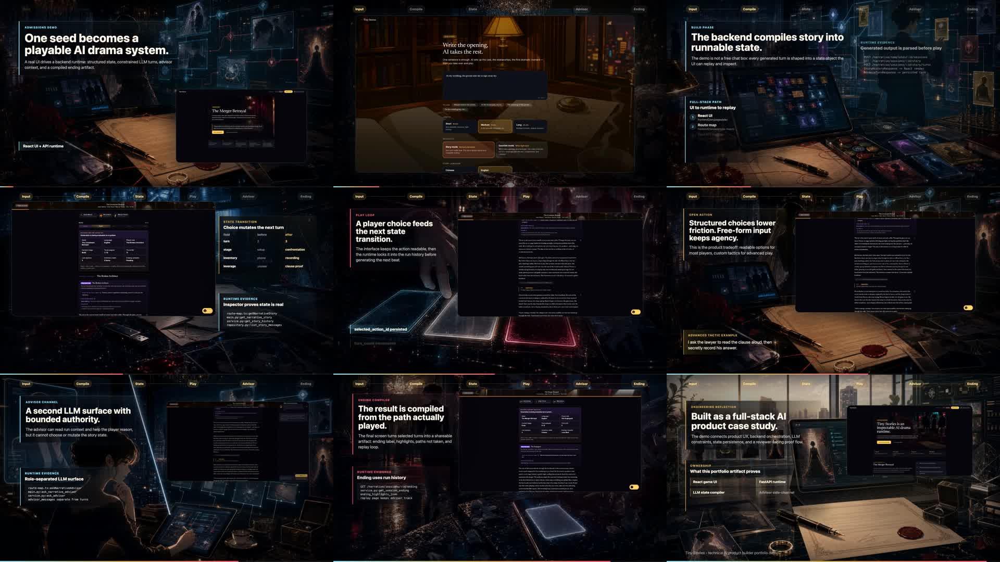

# Tiny Stories

一个互动故事系统:一句开头变成一段 12 回合的故事,每回合可以选选项或自由行动,带存档、回放,以及能逐回合查看状态的 reviewer 视图.

**RPG Demo** 仓库 · [English](./README.md)

<p>
  
  
  
  
  
  
</p>

## Demo

[](https://youtu.be/RRJ7uyjW_nA)

- [在 YouTube 观看 75 秒 demo](https://youtu.be/RRJ7uyjW_nA)
- [同一版本的 MP4](./docs/demo-video/tiny-stories-demo-readme.mp4),适合打不开 YouTube 的环境
- [GitHub Pages 站点](https://lishehao.github.io/RPG_Demo/) 和其中的
  [静态 reviewer demo](https://lishehao.github.io/RPG_Demo/app/#/demo/reviewer)

GitHub Pages 上的 reviewer demo 是静态、确定性的构建:不需要 API key,没有后端,
也没有实时生成.GitHub Pages 上的版本可能落后于 `main`.

## 为什么做

这个项目只问一个问题:LLM 故事生成能不能像一个设计过的游戏循环,而不是一个聊天窗口?

目标玩家想在手机上玩一段短故事,不是空白写作工具,也不是无限信息流.每回合节奏相同:
读场景,比较几个行动(或者自己写一个),行动一次,看清变化,再带着这个后果选下一步.
LLM 负责写文字;外层代码决定每回合要处理什么、保存状态、记录整局,方便回放和检查.

## 怎么运行

需要:

- Python 3.11+
- Node `^20.19.0 || >=22.12.0`(`frontend2/` 用的 Vite 7 要求这个版本)
- 只有实时游玩才需要:一个 OpenAI 兼容的 chat/completions endpoint 和 key

从全新 clone 安装:

```bash
git clone https://github.com/lishehao/RPG_Demo.git
cd RPG_Demo
python3 -m venv .venv
source .venv/bin/activate
python3 -m pip install -e ".[dev]"

cd frontend2
npm install
cd ..
```

### 没有 key(离线模式)

`APP_LLM_MODE=fake` 会把叙事 LLM 换成 `tools/narrative_release_gate.py` 使用的
固定回复 fake gateway,并在启动时种入一个公开故事("The Ledger Room"),保证有东西可玩.

```bash
APP_LLM_MODE=fake \
APP_RUNTIME_STATE_DB_PATH=artifacts/offline_runtime_state.sqlite3 \
uvicorn rpg_backend.main:app --host 127.0.0.1 --port 8000
```

另开一个终端:

```bash
cd frontend2
npm run dev
```

打开 `http://127.0.0.1:8001`(端口写死在 `frontend2/vite.config.ts`;dev server 会把
API 请求 proxy 到 `http://127.0.0.1:8000`).选种入的故事开始玩.

离线模式只用来试 UI 和 API 流程.每回合都返回同样的固定文字,不能用来判断写作质量.
单独的数据库路径可以避免 fake 故事混进实时模式的数据库.

### 有 key(实时游玩)

```bash
cp .env.example .env
# 填写:
#   APP_RESPONSES_PLAY_BASE_URL=...
#   APP_RESPONSES_PLAY_API_KEY=...
#   APP_RESPONSES_PLAY_MODEL=...

uvicorn rpg_backend.main:app --host 127.0.0.1 --port 8000 --reload
```

然后按上面的方式在 `frontend2` 里运行 `npm run dev`,打开 `http://127.0.0.1:8001`.
其他配置见 `.env.example`.既没有 key 也没有设置 `APP_LLM_MODE` 时,后端能启动,
但 `/narrative/templates` 是空的,没有可玩的内容.

### 检查

```bash
python3 -m pytest -q
python3 tools/narrative_release_gate.py --mode fake

cd frontend2
npm run check
npm run build
```

对着运行中的实时后端,`python3 tools/http_product_smoke.py --base-url http://127.0.0.1:8000`
会走一遍 UI 使用的 `/narrative/*` 路径.
`python3 tools/portfolio_public_evidence_preflight.py` 会报告本地 `HEAD` 是否与
`origin/main` 一致,以及 GitHub Pages 上的版本是否是最新的.

## 设计与结果

```text
seed
  -> 故事编译:角色、玩家身份、隐藏目标、筹码关系
  -> 12 回合游玩循环(选项或自由文字行动)
  -> advisor 旁路(能读整局,不能改故事)
  -> 结局编译:结局标签、关键时刻、没走的分支、回放
```

- **先状态,后文字.** 每次调用 LLM 之前,Python 代码先整理本回合:NPC 意图、压力、
  物品、最近的后果.模型返回结构化输出(叙述、选项、NPC 变化、物品变化),
  先持久化再由 UI 渲染.
- **类型化契约.** `rpg_backend/narrative/contracts.py` 里的 Pydantic 模型在
  `frontend2/src/api/contracts.ts` 里有对应的 TypeScript 镜像.
- **LLM 角色分开.** 叙述者、advisor 和结局编译拿到的上下文和权限不同.
- **Reviewer 视图.** `#/play/<session>?reviewer=1` 显示每回合的 seed、阶段、身份、
  选项、物品和结局状态.
- **Demo 防护.** 创作接口需要真实登录 session;公开部署可以关闭创作,并按 IP 和
  用户限制每日 LLM 调用次数.
- **评测.** `tools/narrative_release_gate.py --mode fake` 用 fake gateway 跑核心路径
  (创建、开局、回合、advisor、结局、回放).[Eval v3 redesign](./docs/eval/EVAL_V3_REDESIGN.md)
  和 [RPG Runtime Evaluation Lab](./docs/RPG_EVALUATION_LAB.md)
  ([已部署版本](https://tiny-stories-rpg-evaluation.vercel.app))记录了更完整的评测工作;
  评测分数是确定性诊断,不是校准过的指标.

更深入的文档:

- [Current System Map](./docs/CURRENT_SYSTEM_MAP.md):哪些代码是当前主链路,哪些是遗留
- [Case Study](./docs/CASE_STUDY.md)
- [架构说明](./ARCHITECTURE.zh.md)
- [Code map](./docs/tiny-stories-code-map.md)

## 局限

- 这是一个作品集案例,不是已经验证过的消费级产品.真实需求和复玩都没有被证明;见
  [项目暂停 memo](./docs/PROJECT_PAUSE_2026-05-09.zh.md).
- 实时游玩需要 OpenAI 兼容的 key.离线模式只会返回固定文字.
- `frontend2/` 是当前前端.`frontend/` 目录是历史版本,不再维护.

## 谁做了什么

由 Shehao Li 借助 coding agents 构建(React、TypeScript、FastAPI、Python、SQLite).
故事运行时围绕故事状态、自由文字意图映射、fallback、预算和角色行为来构建;
advisor 可以读取一局的内容,但不能改变故事.

## License

MIT,见 [LICENSE](./LICENSE).
